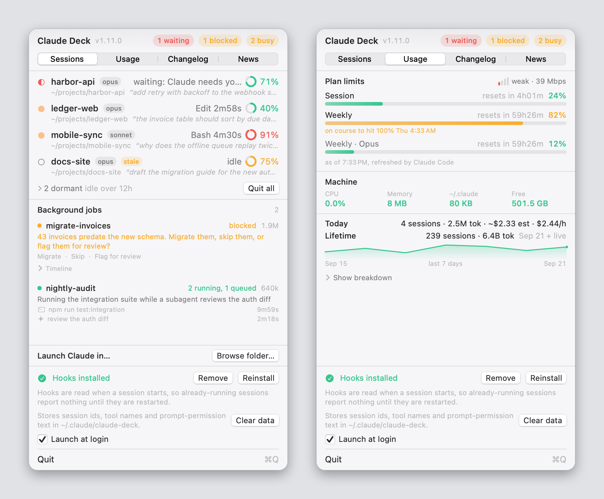
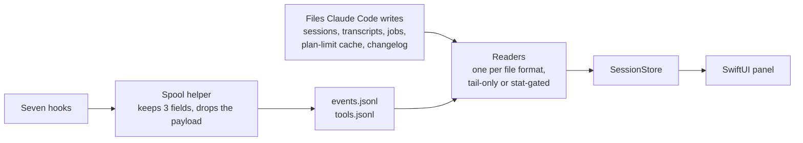

# Claude Deck

A macOS menu bar app that shows what your Claude Code sessions are doing right now: which ones are running, which tool each one is inside, which are waiting on you, how full their context windows are, how close you are to your plan limits, and what today has cost.

[](https://github.com/matuskalis/claude-deck/actions/workflows/build.yml)


[](LICENSE)

<p align="center">
  <picture>
    <source media="(prefers-color-scheme: dark)" srcset="docs/images/hero-dark.png">
    
  </picture>
</p>

<p align="center"><sub>Demo data. The panel is the real one, rendered by the app itself with <code>scripts/demo.sh --snapshot</code>; the sessions, prompts and numbers are invented. <a href="docs/demo.md">How this was made</a>.</sub></p>

It works from the files Claude Code already keeps in `~/.claude`. It holds no API key, and the app itself opens no network connection.

## Install

You need macOS 14 or later and a Swift 6.2 toolchain (Xcode 26 or newer). There is no download: it builds from source, in about a minute, and the bundle is ad-hoc signed.

```sh
git clone https://github.com/matuskalis/claude-deck
cd claude-deck
make install        # builds, signs, copies to ~/Applications/Claude Deck.app
open ~/Applications/"Claude Deck.app"
```

A terminal icon appears in the menu bar. Click it. Three things to know on first use:

- **Install hooks** in the panel footer is what makes permission prompts, finished turns and the tool each session is inside visible. Without it the list and the meters still work. The installer edits `~/.claude/settings.json` after taking a backup, and **Remove** takes out exactly what was added. [What it records](docs/hooks-and-privacy.md).
- The first time it raises a terminal window or starts a session, macOS asks for Automation permission for iTerm or Terminal.
- **Launch at login** only works from `~/Applications` or `/Applications`, which `make install` takes care of.

To remove it: press **Remove** in the footer, quit, delete the app, and delete `~/.claude/claude-deck`.

**No Claude Code sessions on this machine?** `make build && scripts/demo.sh` starts the app on invented data, in a throwaway home directory that is deleted when you stop it. It touches nothing under your real `~/.claude`.

## What it shows

| Tab | What is on it |
|---|---|
| **Sessions** | Every live `claude` session with its tool, how long it has been busy, its context ring and its last prompt. Sessions waiting on a permission prompt sort first. Idle tabs left open for days fold into one row. Background jobs get their own section, and a job blocked on a question says what it is asking. |
| **Usage** | Plan limits with a forecast of when the tightest one fills, Wi-Fi link quality, what the sessions cost the machine, and today's tokens and estimated spend. |
| **Changelog** | What changed in Claude Code, read from the changelog it already keeps on disk. |
| **News** | What changed across the other AI coding tools and the people building them, summarised on demand by the Claude Code you already have. |

It also notifies you when a session blocks, finishes or dies on a rate limit, takes you back to the terminal a session is running in, and starts new ones from a folder picker. [All of it, in detail](docs/sessions.md).

## How it works



Everything is read from disk. A 3 second timer rescans `~/.claude/sessions`, file watchers pick up hook events in well under a second, and two slower timers (15 and 60 seconds) refresh the meters and the token counts. The big files are never re-read in full: a transcript is read backwards from the end in 64 KB chunks, because only its newest assistant message is needed, and the token counts read only what was appended. [The refresh model and every file it reads](docs/how-it-works.md).

## Decisions, and what they cost

**It reads the disk and never calls an API.** The numbers come from Claude Code's own files, so there is no key to hold, leak or rotate. The cost: those files are an undocumented internal format that can change without notice, so every field is optional and anything unrecognised degrades to "unknown" instead of dropping a row. Plan limits are only as fresh as Claude Code's last fetch, and the panel prints that time under them.

**Hooks record only what the menu shows.** A hook payload carries your prompt, the full tool input (a whole file, on a `Write`) and the tool result. The spool helper keeps three fields and throws the rest away, and a test pushes a payload containing a token and a private path through the real helper and asserts that neither reaches disk. The cost: hooks have to be installed into a file you own. The installer is a text splice that leaves every other byte alone. Its tests check that removing it restores a normally formatted file byte for byte, and loses nothing in any layout.

**Nothing is ever signalled on the strength of a pid.** **Quit all** on the dormant row sends `SIGTERM` (never `SIGKILL`) to sessions whose status is exactly `idle` for more than 12 hours, and re-proves each process against its recorded start time at the moment you click. A session with no status, or one this build does not recognise, is never counted as dormant. The cost: such a session never folds away and cannot be quit from the menu.

**One fixed box per tab, and nothing scrolls** (three bounded exceptions: the dormant list, a job's timeline, and the token breakdown). A page that does not fit is a page trying to be two pages, so the deck was split into tabs, and the list tabs are master and detail. The cost: caps of six sessions and two jobs, and a tab that is simply full when it is full (see the limits below).

## Numbers

Measured in this repository on 30 Sep 2026, an M1 Pro running macOS 27 with a Swift 6.4 toolchain, while the machine was busy with other work:

| | |
|---|---|
| Tests | 192 in 21 suites; 3 s on CI, about 5 s on a quiet laptop; the ones that write files run against a throwaway home directory |
| Release build | 45 to 60 s from cold (two runs), 2.3 MB ad-hoc-signed bundle |
| Code | 28 Swift files, 5,589 lines, plus 3,329 lines of tests |
| Dependencies | none |

Measurements the author took against a live machine on 11 Aug 2026, not re-run here: [what the Machine row was checked against](docs/usage-tab.md#machine).

## Status and limits

- **Platforms.** The deployment target is macOS 14. It was built, tested and run here on macOS 27, and CI builds and tests it on GitHub's `macos-latest`. It has not been run on macOS 14, 15 or 26.
- **Claude Code.** Developed against 2.1.220 and checked against 2.1.226 in August 2026. Not re-checked since. A version that renames a file will show an empty list, not a wrong one.
- **Focus** raises the exact iTerm or Terminal.app window or split pane. A session inside tmux, an IDE terminal or a detached process cannot be reached, and the app says so.
- **Ad-hoc signed, not notarised.** Built locally there is no quarantine attribute, so Gatekeeper does not get involved. It is not meant to be distributed as a binary.
- **News costs money.** Refresh runs a headless `claude -p` session on your plan (the author measured one run at 20 turns and $0.88). It only runs when you press the button, and it refuses when a limit is already critical.
- **A tab is a fixed box.** The Sessions tab is 410 points tall. In a demo rendering with five live sessions, three dormant ones (which also brings up the filter box) and two jobs, the content ran past the box and drew over the footer. The caps are meant to prevent that and do not fully. Not fixed here.
- `make run` stops every running Claude Deck before it starts the new build, including an installed one.

## Develop

```sh
swift build
swift test                                # 192 tests
make build                                # release build, assembles dist/Claude Deck.app
scripts/demo.sh                           # the app on invented data
scripts/demo.sh --snapshot docs/images    # regenerate the images above
```

The tests never touch your real `~/.claude`: on macOS `HOME` does not move `NSHomeDirectory()`, so each suite that writes fixtures points it at a temporary directory with `CFFIXED_USER_HOME` and refuses to run if the redirect did not take. [Layout, tests, CI and the release path](docs/development.md).

## Documentation

| | |
|---|---|
| [Sessions](docs/sessions.md) | The menu bar icon, session rows, focus and launch, dormant sessions, background jobs, notifications |
| [Usage tab](docs/usage-tab.md) | Plan limits and the forecast, Wi-Fi, the machine row, tokens and cost |
| [Changelog and News](docs/changelog-and-news.md) | Where each comes from, what the sliders do, what News costs |
| [Hooks and privacy](docs/hooks-and-privacy.md) | What the hooks record, how the installer edits `settings.json`, what the app reads and writes |
| [How it works](docs/how-it-works.md) | Session liveness, reading transcripts, context percentage, the refresh model |
| [Demo mode](docs/demo.md) | Running on invented data, and how the images are made |
| [Development](docs/development.md) | Layout, tests, CI, the release path |

## Licence

MIT. See [LICENSE](LICENSE).
